
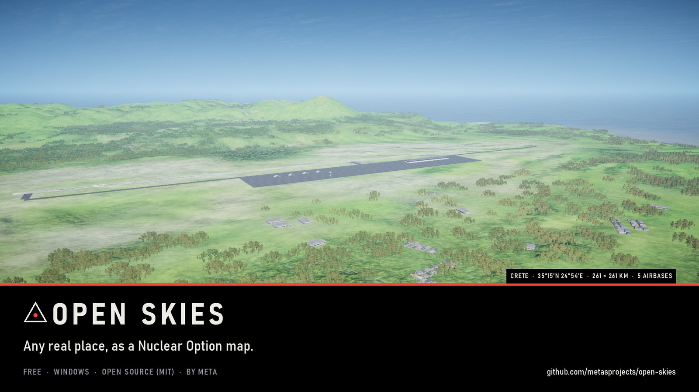

<h1 align="center">Open Skies</h1>

<b>Any real place, as a Nuclear Option map.</b> 
A free Windows app: pick a place, tick its real airbases, press Build, then fly it.

<a href="https://github.com/metasprojects/open-skies/releases/latest"><b>Download the latest release</b></a> ·
<a href="#how-it-works">How it works</a> ·
<a href="#what-you-need">What you need</a> ·
<a href="#problems">Problems</a> ·
<a href="../LICENSES.md">Credits</a>

---

## What a map gets

Up to **261 x 261 km** of a real place, built from open data in 30 to 60 minutes:

- real ground heights at 30 m, the coastline and the sea floor
- ground painted from satellite land cover (sand for deserts)
- the road network with bridges, real buildings and whole towns, forests, rivers and lakes
- ship lanes from real ship traffic
- the real airbases you pick, with paved runways, their real runway numbers and markings, taxiways and aprons
- missions to fly: **Free Flight** (both sides, every aircraft), **Escalation** (PvP or co-op: capture every enemy
  airbase) and a **Strike** for each side

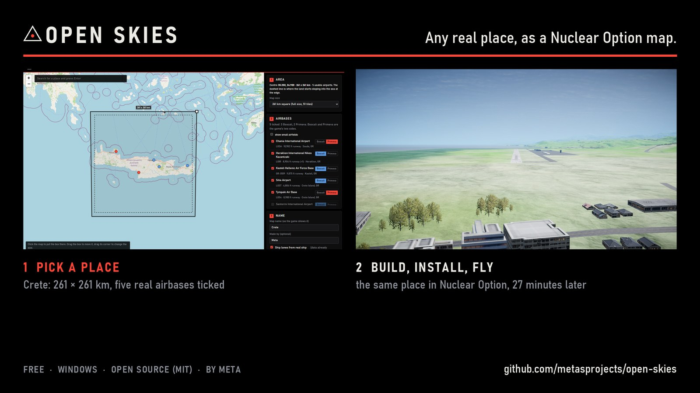

## How it works

1. **Download** the zip from [Releases](https://github.com/metasprojects/open-skies/releases/latest), right-click it,
   choose Properties, tick **Unblock**, and unzip it anywhere with about 15 GB free.
2. **Double-click `OpenSkies.bat`.** The first run sets everything up: a private copy of Python, the mod loader
   (BepInEx), the map loader (NOCustomMaps) and Unity 2022.3.62f2. Signing in to a free Unity account is the one
   step you do by hand.
3. **Pick a place.** Search or click the map; tick the real airports you want and give each a side (Boscali or
   Primeva); name the map.
4. **Build.** Twenty steps with a progress bar. If one fails, the message says why and what to do, and pressing
   Build again carries on from there.
5. **Install** puts the map and its missions into the game. Start Nuclear Option and fly.

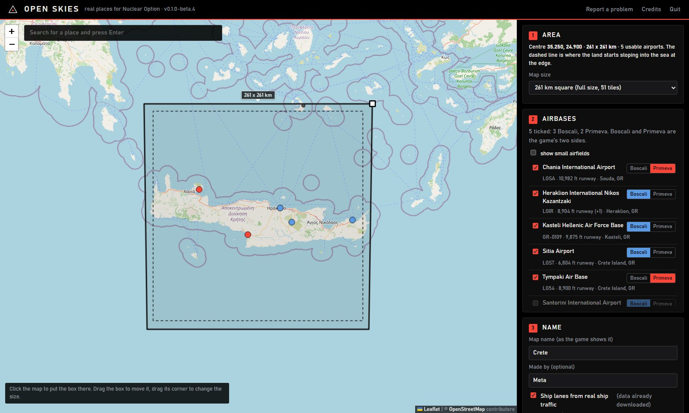

## Crete, built by Open Skies

Every picture is a real, untouched in-game screenshot.

| | |
|---|---|
| 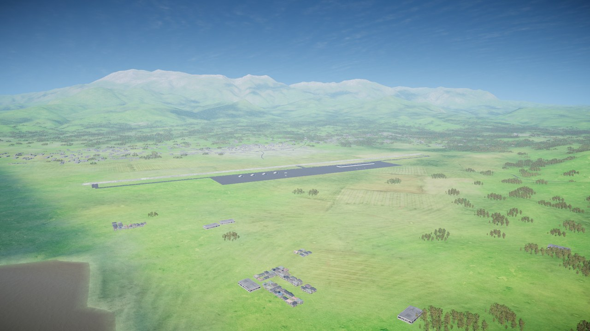 | 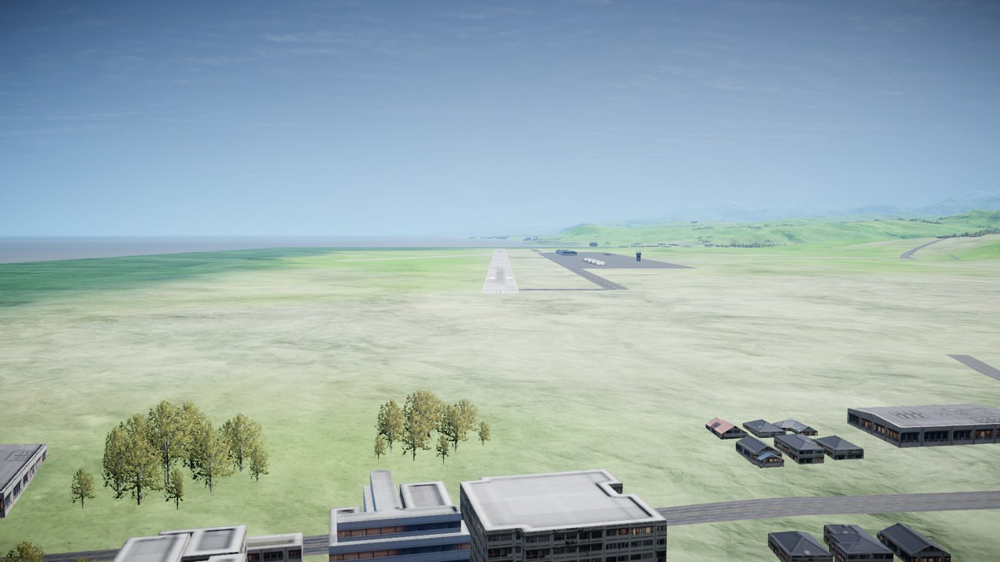 |
| Tympaki airbase under Mount Ida (2,456 m) | Short final into Heraklion, over the town |
| 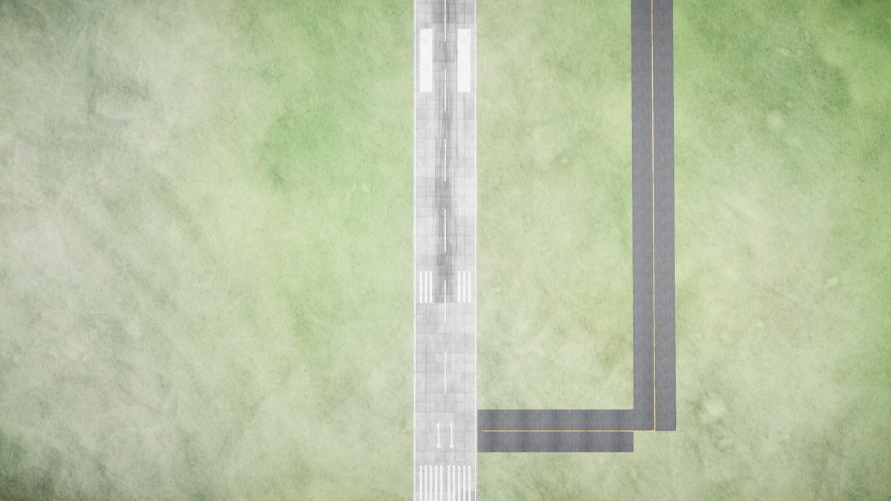 | 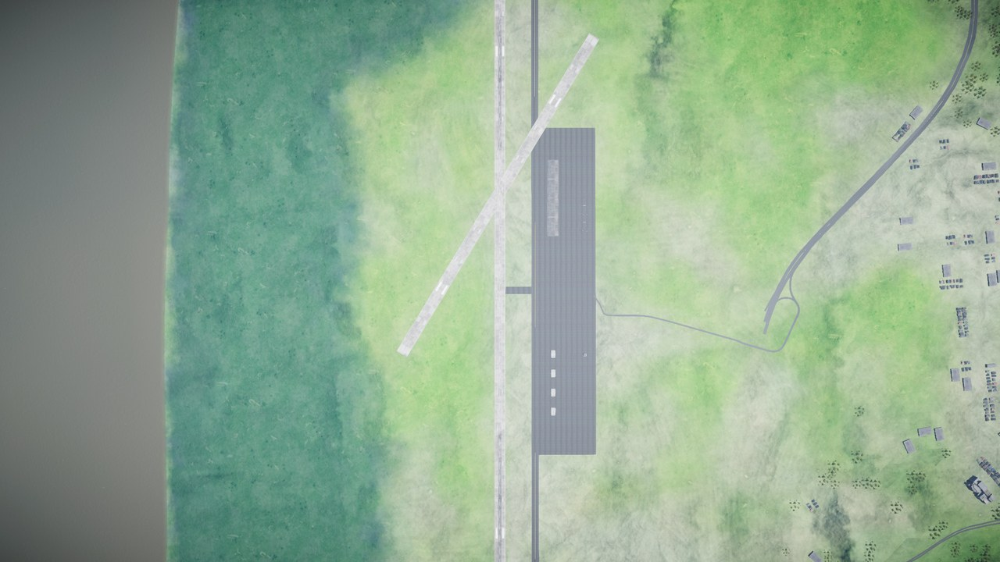 |
| Runway 11 at Chania from above: real numbers, bars, a taxiway | Heraklion from 1,700 m: both runways, the apron, the roads in |
| 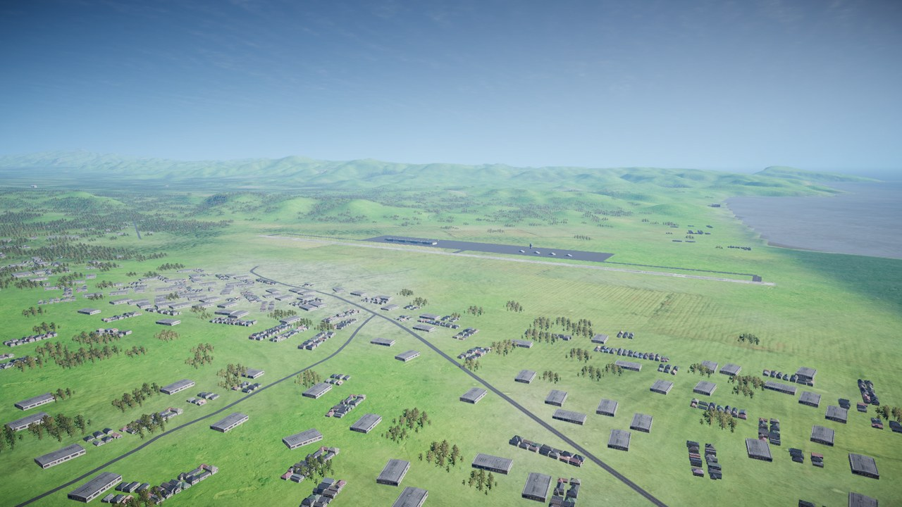 | 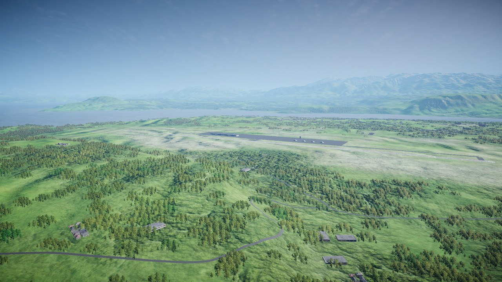 |
| Tympaki's streets, with the airbase behind | The White Mountains over Chania's airfield |
| 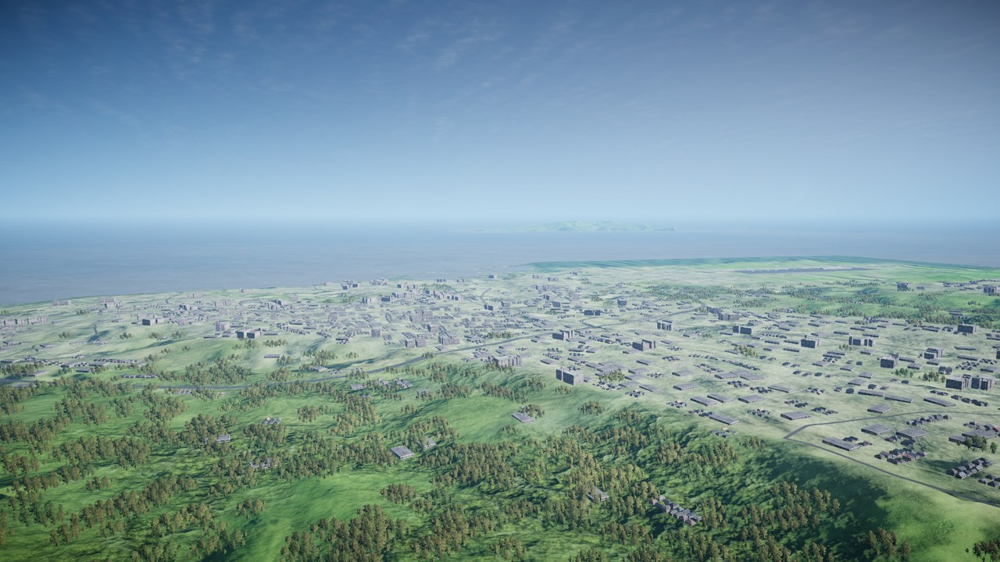 | 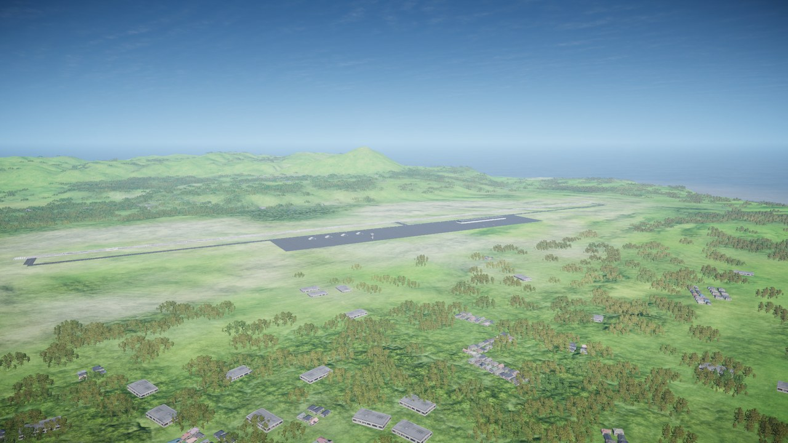 |
| Heraklion, the island's largest city | Chania's airfield and the north coast |

Map data: Copernicus DEM; OpenStreetMap contributors, Overture Maps and others.

## What you need

- Windows 10 or 11, 64-bit (not Mac, Linux or SteamOS)
- Nuclear Option on Steam
- 8 GB of memory or more (16 GB is comfortable)
- About 15 GB free while a map builds, plus about 6 GB for Unity; a finished map is 1 to 3 GB
- An internet connection and a free Unity account

## Multiplayer

Everyone needs the same build of a map: share the `.nomap` file from the map's folder instead of building it
again. The map loader can't read maps from Workshop downloads yet, so maps are shared as files.

## Problems

Press **Report a problem** in the app. It saves one zip with the logs and the setup check, with your Windows user
name taken out. Then [open an issue](https://github.com/metasprojects/open-skies/issues/new/choose) and attach it.
Running `Setup.bat` again fixes most setup problems. More in [docs/TESTING.md](../docs/TESTING.md) and the
[README](../README.md).

## Credits

Open Skies is free and open source under the [MIT licence](../LICENSE.txt), by **Meta**. It builds on
[NOCustomMaps](https://github.com/BatongMaster/NOCustomMaps) (MIT), BepInEx (LGPL-2.1), KnoxMap (MIT) and Leaflet
(BSD-2-Clause). Every map carries the credits for its data: Copernicus DEM (DLR, Airbus, EU, ESA), ESA WorldCover
(CC BY 4.0), OpenStreetMap contributors through Overture Maps with TomTom, Esri, Microsoft, Google and others (ODbL,
CC BY 4.0, CDLA Permissive 2.0), World Bank/IMF ship traffic (CC BY 4.0), OurAirports and AWS Terrain Tiles. The
full list is in [LICENSES.md](../LICENSES.md).

This project is an unofficial community modification and is not affiliated with, sponsored by, or endorsed by
Shockfront Studios Pty Ltd. Original Nuclear Option assets, vehicle designs, audio, and code are Copyright (c) 2026
Shockfront Studios Pty Ltd. All rights reserved. Nuclear Option and Shockfront Studios are trademarks or registered
trademarks of Shockfront Studios Pty Ltd. Original mod content and all other trademarks belong to their respective
owners. Mods for Nuclear Option may not be sold or put behind a paywall.
